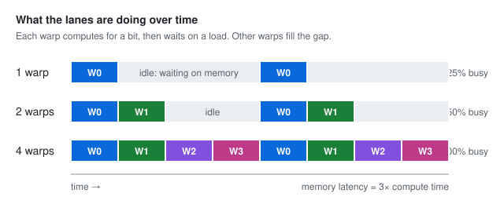
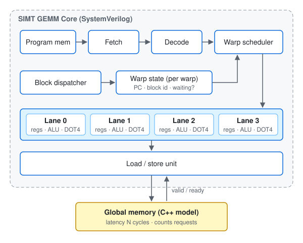

# SIMT GEMM Core

A small GPU-style core in SystemVerilog that runs INT8 matrix multiply (GEMM).
An extension of my Advanced Computer Architecture (ACA) module at Imperial.

## The idea

CPUs hide memory latency by making one thread clever (out-of-order, caches, prediction).
GPUs hide it by having lots of threads: when one waits on memory, run another.
This project builds that second idea and measures it.

**Main question:** how many warps does it take to keep the core busy at a given memory latency?



## What I'm building



- **Warp** = a group of 4 threads (lanes) running the same instruction together.
- **Scheduler** picks a ready warp each cycle. A warp waiting on a load is skipped.
- **DOT4** = 4 INT8 multiplies summed into one INT32 (like Arm `SDOT`). The core of GEMM.
- **Memory** lives in C++, with a latency I can change and a request counter.

| Setting | v1 |
| --- | --- |
| Lanes per warp | 4 |
| Warps | 1, 2 or 4 (the experiment) |
| Registers per lane | 16 x 32-bit |
| Memory latency | 5, 20, 50 cycles |

Kept simple on purpose: no branches, no pipeline, no assembler.

## Instructions (v1)

Encoding: `[31:26] opcode | [25:22] rd | [21:18] rs1 | [17:14] rs2 | [13:0] imm14`.
`LI` uses `[17:0]` as `imm18`.

| Instruction | Does |
| --- | --- |
| `LI rd, imm` | rd = imm |
| `ADD rd, rs1, rs2` | rd = rs1 + rs2 |
| `ADDI rd, rs1, imm` | rd = rs1 + imm |
| `S2R rd, sreg` | rd = lane id, warp id or block id |
| `LD rd, imm(rs1)` | load a word from memory |
| `ST rs2, imm(rs1)` | store a word to memory |
| `DOT4 rd, rs1, rs2` | rd += four INT8 products |
| `HALT` | this block is done |

## Milestones (small steps)

One step = one commit = one new passing test.

| Step | Build | Done when |
| --- | --- | --- |
| 0 | Setup: repo, CI, `make tools` | CI is green with zero testbenches |
| 1 | `core_pkg.sv`: opcodes, field widths, parameters; matching C++ encode header | `sw/tests/encode_test.cpp`: encode then decode every v1 instruction round-trips |
| 2 | Register file, one lane: 16 x 32-bit, 2 read ports, 1 write port | `regfile_tb`: random writes and reads match a C++ array |
| 3 | ALU: `ADD`, `ADDI`, `LI` | `alu_tb`: 1,000 random cases match C++ |
| 4 | `DOT4` unit: 4 signed INT8 products summed into INT32 | `dot4_tb`: random and edge cases (-128 x -128) match C++ |
| 5 | Decoder: instruction word to control signals | `decoder_tb`: each v1 instruction decodes correctly |
| 6 | Core, one lane: program memory, fetch, decode, execute `LI ADD ADDI HALT` | `core_tb`: a 5-instruction program leaves the right registers |
| 7 | Four lanes plus `S2R` (lane id) | each lane holds its own result after `S2R` and `ADD` |
| 8 | C++ memory model: valid/ready, configurable latency, request counter | memory test passes; handshake assertion never fires |
| 9 | `LD` and `ST` in the core; core waits on loads | `vadd` matches the golden model |
| 10 | `DOT4` in the core | one block of `gemm_dot4` (4 outputs) matches |
| 11 | Block dispatcher: grid of blocks, block id via `S2R` | full 8x8 `gemm_dot4` (16 blocks) matches; cycle count printed |
| 12 | Second warp and round-robin scheduler; switch while a warp waits on a load | same GEMM still matches, with fewer cycles |
| 13 | `WARPS` parameter (1/2/4); sweep script writes CSV; plot | headline plot in `results/` and README |

**Next:**

| Step | Build | Done when |
| --- | --- | --- |
| 14 | Per-warp 4x4 INT32 accumulator tile and `MOPA` | unit test of one outer product matches C++ |
| 15 | Tile store instruction and `gemm_mopa` | GEMM matches; compare cycles and register reads with `gemm_dot4` |
| 16 | `LDV` vector load (one request for the warp) | `gemm_ldv` matches; compare request counts with per-lane loads |

## Build

Needs Verilator 5.x and g++. Yosys for `make synth`.

```
make tools               # check tool versions
make lint TOP=<module>   # check the RTL
make sim  TOP=<module>   # run tb/<module>_tb.cpp
make test                # run every test
make synth TOP=<module>  # hardware cost (LUTs, flip-flops, DSPs)
```

Two rules so both Verilator and Yosys accept the code:
- Write `core_pkg::OP_ADD`, not `import core_pkg::*`.
- Wrap assertions in `` `ifndef SYNTHESIS ... `endif ``.

## Folders

```
rtl/       SystemVerilog, one module per file
tb/        C++ testbenches (<module>_tb.cpp)
sw/        C++ helpers and golden models; sw/tests/ for pure C++ tests
kernels/   programs, as lists of encoded instructions
results/   CSVs and plots
docs/      diagrams
```
